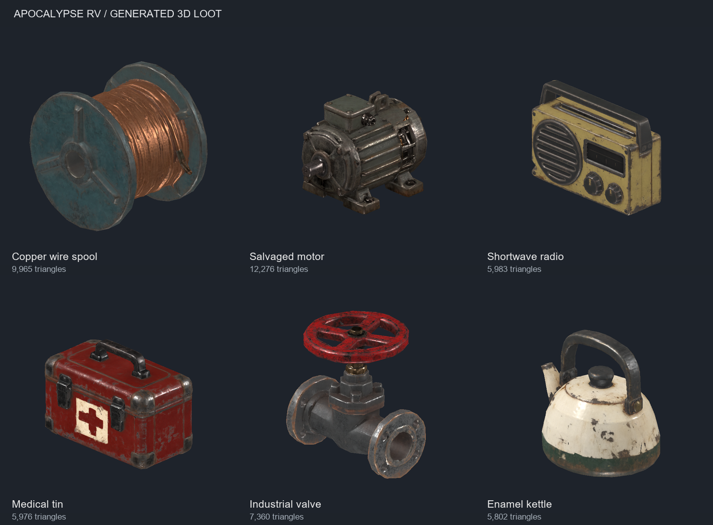

# 搜刮物資參考圖：第一批

日期：2026-10-24。階段：六件貼圖 3D 模型已接入正式教學倉庫，支援拾取、背包、丟棄、回收與保存。

每件物資各一張透明 RGBA PNG、單件完整三分之四視角；可將個別 `reference.png` 作為 ComfyUI 單圖輸入。圖片由內建 `image_gen` 生成，完整提示詞由 [prompts.json](prompts.json) 的 `shared_prompt` 加上對應 `subject` 組成。造型強調可辨識的輪廓、厚把手與主要材質分區；細部磨耗在模型製作時應以貼圖表現。

下表尺寸、單／雙手分類與收益皆為提案，不代表現有遊戲規則或已實作功能。尺寸是預計模型外接範圍，單張圖片不保證精確比例。

| 物資 | 參考圖 | 建議尺寸 | 搬運提案 | 用途提案 |
| --- | --- | --- | --- | --- |
| 銅線捲盤 | [PNG](copper_wire_spool/reference.png) | 28 × 24 × 28 cm | 單手 | 可分解為銅與少量鋼材的回收物。 |
| 報廢馬達 | [PNG](salvaged_motor/reference.png) | 42 × 27 × 30 cm | 雙手 | 沉重的高價值回收物，可提供鋼、銅與機械零件。 |
| 故障短波收音機 | [PNG](broken_shortwave_radio/reference.png) | 32 × 12 × 22 cm | 單手 | 可分解為電子元件；是否能修復留待玩法設計。 |
| 密封醫療鐵盒 | [PNG](medical_tin/reference.png) | 30 × 20 × 12 cm | 單手 | 補給容器提案；治療與內容物尚未實作。 |
| 生鏽工業閥門 | [PNG](industrial_valve/reference.png) | 32 × 20 × 36 cm | 單手 | 機械回收物，可提供鋼材與少量黃銅。 |
| 搪瓷熱水壺 | [PNG](enamel_kettle/reference.png) | 27 × 21 × 25 cm | 單手 | 常見生活廢品，可分解回收少量金屬。 |

美術方向沿用 [GDD 工業恐怖規範](../../GDD.md)：低飽和、舊漆、鏽蝕與簡化結構。搜刮工業廢品的題材參考 [Lethal Company 官方介紹](https://store.steampowered.com/app/1966720/Lethal_Company/)，本批為原創道具造型。

參考圖階段已檢查 PNG 的 RGBA／透明通道及完整輪廓。以下為後續實際生成與檢查結果。

## 3D 模型

每件使用既有 ComfyUI TRELLIS.2 單圖流程，1024、seed 42、生成目標 50k 面，僅提交一次。原始檔保留於各來源目錄的 `raw.glb`，`generation.json` 記錄工作 ID、來源 hash 與原模檢查；`model_parameters.json` 記錄尺寸、旋轉、降面、貼圖 hash 及限制。模型以公尺計、+Y 向上、底部置中，表中尺寸順序為 X／Y／Z。

| 模型 | 原模三角面 | 成品三角面 | 基礎 GLB 尺寸 cm（X／Y／Z） |
| --- | ---: | ---: | --- |
| [銅線捲盤](../../assets/models/scavenge_loot/copper_wire_spool.glb) | 49,935 | 9,965 | 28／28／24 |
| [報廢馬達](../../assets/models/scavenge_loot/salvaged_motor.glb) | 49,520 | 12,276 | 27／30／42 |
| [故障短波收音機](../../assets/models/scavenge_loot/broken_shortwave_radio.glb) | 49,888 | 5,983 | 32／22／12 |
| [密封醫療鐵盒](../../assets/models/scavenge_loot/medical_tin.glb) | 49,808 | 5,976 | 30／22／18 |
| [生鏽工業閥門](../../assets/models/scavenge_loot/industrial_valve.glb) | 49,490 | 7,360 | 32／36／27 |
| [搪瓷熱水壺](../../assets/models/scavenge_loot/enamel_kettle.glb) | 48,364 | 5,802 | 27／25／21 |

使用 [共用靜態道具工具](../../.agents/skills/comfyui-image-to-3d/references/static-props.md) 與 gltfpack 1.3（ratio 0.12、error 0.025）；誤差限制使部分道具未達 12% 面數，保留實際結果。沒有放寬誤差或強制達標。原本約 297k 面降至合計 47,362 面，嵌入貼圖 bytes 全數保留。

馬達繞 Y 旋轉 180°，醫療箱旋轉 90°，使輸出軸／醫療符號朝 +Z。醫療標記沿用原模，沒有額外新增標記。醫療箱厚度與閥門深度由原先概念提案調整，保留箱體及圓形手輪的比例。

## 生成階段檢查與限制

- 已在獨立 Godot 4.7.2 檢視器逐件檢視材質／素色的正、側、背、斜、頂、底六視角，並比較校正原模與降面版的斜視角。主要輪廓、把手孔與閥輪開口仍可辨識；單圖未見細節由生成器推測，局部金屬與捲線保留起伏。
- 六件 GLB 的容器、索引與浮點屬性有效；法線／切線檢查無異常。尺寸及底部原點以頂點外接範圍驗證至 1 µm 容差，這不是平面度或支撐穩定度的保證。
- 生成／降面網格仍有非流形邊與重複幾何面；位置以 1 µm 合併後，各件數量記錄於參數檔。銅線捲盤及收音機另有 9／3 條邊界邊，六件均無零面積三角形。這批為靜態道具外觀資產，未宣稱完成乾淨重拓樸或封閉實體。
- 以上為生成階段結果；當時未接入遊戲。生成、失敗候選、檢查圖與暫存工具留在已忽略的 `.godot/art-work/scavenge_loot/20261024-01/`。

## 教學整合

[六件 Item wrapper](../../props/scavenge_loot/) 以自身中心為物理原點，視覺子節點向下移基礎模型半個高度，再由 Visuals 等比縮放至遊戲尺寸；剛體根節點維持單位尺度。捲盤用橫向圓柱碰撞，其餘用獨立方盒，碰撞各自配合遊戲尺寸；不使用生成模型的非流形網格作碰撞。各件附 256 px 透明原模渲染背包圖示。

[正式教學倉庫](../../world/orientation_shelter/orientation_shelter.tscn) 的 Scrap A–F 依序替換為捲盤、收音機、馬達、醫療鐵盒、閥門、熱水壺，G／H 保留原廢料。調整六個 Marker 的朝向與中心高度，使模型底面保持在 0.825 m 貨架面上，正面朝走道；原本八件物資的 ID 及每件三份 Metal Parts 不變，連同兩個油桶仍共 28 Metal Parts／20 Unrefined Fuel。馬達重 12 kg，使用既有大型物品／雙手規則。醫療盒目前是可回收物，沒有治療功能，也沒有新增銅材或電子元件資源。

新遊戲只在首訪建立物資；現有當前格式存檔仍保留其已保存的場景／ID／狀態，不自動替換、補發或改版本。[教學配置](../../world/tutorial_shelter/opening_site_content.gd) 與 [Checkpoint 角色檢查](../../rv/checkpoint.gd) 共用新角色場景對應，並限定允許原廢料或同角色的新物品。

尺寸調整（2026-10-24）：以手持、搬運用途及角色比例調整大小，保留每件原有長寬高比例。GLB／原模與貼圖不變，下表為 wrapper 實際遊戲尺寸；貨架 Marker 中心高度同步為 `0.825 + 高度 / 2`。重量、單／雙手分類、產量與 ID 不變。

| 物資 | 等比倍率 | 遊戲尺寸 cm（X／Y／Z） |
| --- | ---: | --- |
| 銅線捲盤 | 1.30 | 36.4／36.4／31.2 |
| 收音機 | 1.25 | 40／27.5／15 |
| 馬達 | 1.40 | 37.8／42／58.8 |
| 醫療鐵盒 | 1.35 | 40.5／29.7／24.3 |
| 工業閥門 | 1.20 | 38.4／43.2／32.4 |
| 熱水壺 | 1.20 | 32.4／30／25.2 |

尺寸調整驗證：六件 wrapper 的實際網格外接尺寸、碰撞外接尺寸、中心原點及 0.825 m 貨架接觸高度核對一致。`test_item_player.gd` 與 `test_orientation_departure.gd` 兩支局部測試 PASS（`.godot/test-logs/20261024-180305-747-selected-38960/`），包含拾取／保存及放大馬達的正式回收與出庫旅程。原生教學視窗逐件觀察貨架比例、拾取、低位手持與丟棄；檢查 fixture 以原生 E／G 事件操作，正式持物程式沒有改動。乾淨檢查日誌為 `.godot/art-work/scavenge_loot/tutorial_integration/resize_clean.log`，無腳本或快照錯誤。

本次驗證：

- `test_item_player.gd`：六件物資由正式 InteractRay 命中碰撞後，以實體 E 鍵事件拾取；背包圖示、磁碟背包序列化、手持節點重建、丟棄與世界 Item 狀態還原通過。最後一次局部測試於 `.godot/test-logs/20261024-144155-783-selected-6596/`，PASS。
- `test_orientation_departure.gd`：正式 A–H 場景／ID／固定產量、角色種類拒收、既有廢料保存與不重複生成，以及原回收／維修／真實輪驅出庫／封門／讀檔旅程通過。與初次 Item 檢查的局部執行紀錄為 `.godot/test-logs/20261024-143324-370-selected-27112/`，兩支測試 PASS。
- 原生 Godot 教學視窗：逐一觀察六件實際貨架上的模型、接觸高度及命名提示，日誌無腳本錯誤；測試視窗已關閉。視角與玩家位置由忽略目錄內的檢查 fixture 控制，正面 +Z 另依走道方向核對。E 拾取成功屬上述引擎輸入事件自動測試。
- 未做新道具同屏效能、完整持物動作或所有丟棄姿態的人工驗收；局部手持觀察見上方尺寸調整紀錄。沒有重跑完整測試套件。物品沿用既有放置／分解系統，沒有新增功能、存檔欄位或全局互動規則。
