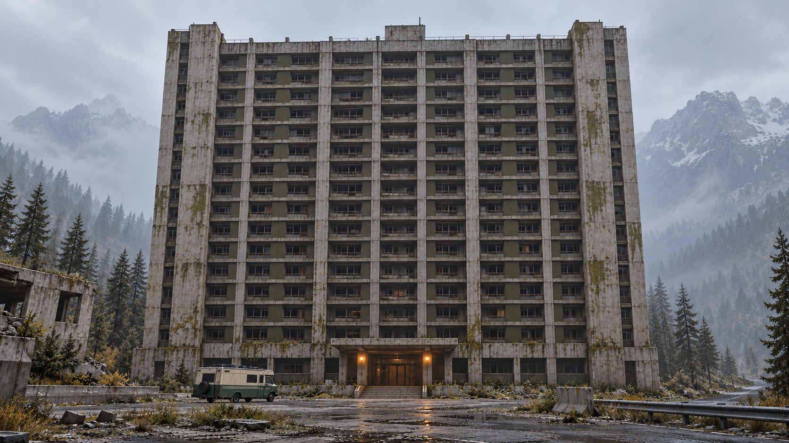
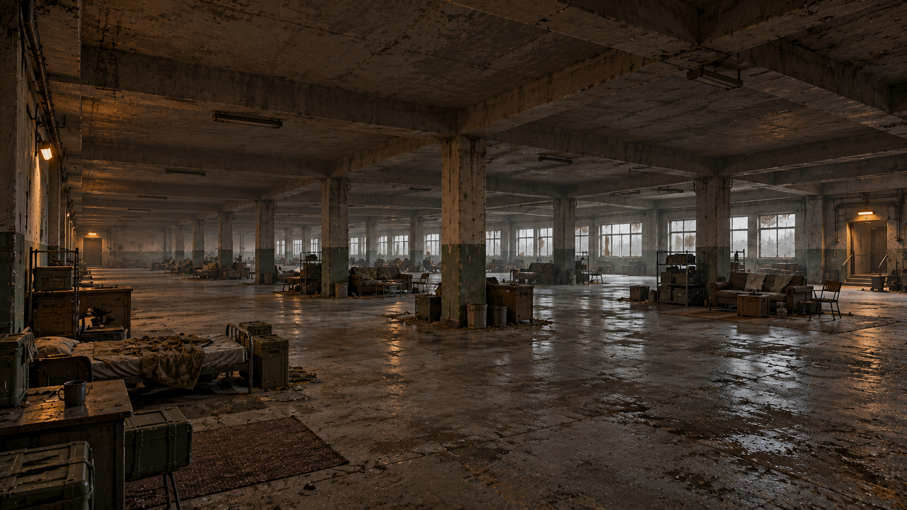

# 灰井住宅城概念圖

2026-10-27：以下第一／二版圖像已是歷史提案。現行外觀改為無窗、灰綠冷灰、八類低模零件與三種程序樓型，並已完成外殼實作；以[外觀指南](../../guides/megashelter-exteriors.md)與[本輪驗證](../../validation/2026-10-27-modular-megashelter.md)為準。舊窗格及室內圖不再作製作依據。

2026-10-22，第二版：依使用者回饋改為簡單對稱長方體、每層一個大空間與隨機內容，取消中庭及固定樓層用途。本目錄圖像由內建 `image_gen` 產生，非遊戲實機截圖、既有模型或 2077 官方素材。當前採用兩張 v2 圖；第一版保留作歷史參考。圖中樓數、屋頂細節及陳設不是工程尺寸，室內只示意一個可能的隨機配置；實際製作以[副本計畫](../../plans/abandoned-megablock.md)的灰盒與低模規格為準。`.gdignore` 使本目錄圖像維持文件用途，不進入 Godot 資產匯入。

## 2026-10-22 第二版（歷史）

- [exterior-concept-v2.png](exterior-concept-v2.png)：完整對稱長方體、重複窗格、置中入口與 RV 尺度。
- [open-floor-concept-v2.png](open-floor-concept-v2.png)：單層連續大空間、柱列及隨機家具群示例；不指定樓層或用途。





## 第一版歷史圖像

- [exterior-concept.png](exterior-concept.png)：原 U 形量體與較複雜服務核心，已由第二版取代。
- [atrium-concept.png](atrium-concept.png)：原中庭／連橋方案，已取消，不作目前建模依據。

## 第一版原作研究來源（歷史）

以下連到製作人作品頁，保留最初研究來源；第二版採用獨立的完整量體與開放樓面。外部作品只作研究參考，沒有下載或收錄原作圖像。第二版編輯輸入只使用本專案第一版的生成圖。

- [Krzysztof Olborski — Megabuilding / Cyberpunk 2077](https://krzysztofolborski.artstation.com/projects/WmWPDQ)：作者說明內外模組、組裝與優化工作。第一版曾借鏡重複住宅格、巨型量體及中庭的空間組織；第二版已取消中庭。
- [Marcin Stępień — Cyberpunk 2077 Megabuilding Lighting](https://mstepien.artstation.com/projects/OoB4yg)：作者的巨型住宅燈光作品。第一版曾借鏡中庭明暗層次；目前第二版改為單層外牆窗光、柱列陰影及樓梯微光。

上述第一版研究不代表原作者對本專案的建議。灰井住宅城第二版依使用者回饋採用獨立的對稱完整量體、開放樓面、末日工業材質及原創名稱。

## 第一版生成紀錄（歷史）

- 模式：內建 `image_gen`，每張一個獨立 generate 呼叫，非 CLI／API fallback；未輸入參考圖片，背景不透明。
- 外觀原始輸出：`exec-91454009-ba85-482e-90b3-7cb0ea474020.png`。
- 中庭原始輸出：`exec-0384032a-bbff-4823-8941-608824c3ead3.png`。
- 已檢視圖像中的外觀／中庭／入口與動線意圖；場景實作仍需驗證實際尺度、碰撞、通路、光照及效能。

### 外觀完整提示詞

```text
Use case: stylized-concept.
Asset type: original game environment concept artwork for ApocalypseRV, a low-poly industrial survival horror game. This is an art-direction proposal, not an existing game screenshot.
Primary request: a colossal ABANDONED RESIDENTIAL MEGABLOCK called GRAYWELL BLOCK, inspired by the broad architectural idea of a vertical housing city with a hollow atrium, transformed into a grounded post-collapse concrete ruin.
Architecture: one coherent 96 meter wide, 72 meter deep, roughly 24-storey 116 meter tall residential megastructure, a chunky U-shaped rectangular volume around a deep open-air central courtyard. Many repeated small housing bays, huge external concrete ribs, two asymmetric service cores, recessed communal decks, pipes and sparse broken railings. It feels heavy and inhabitable, with engineered supports and believable facade grids. Most upper storeys dark and inaccessible. Original silhouette and layout.
Scene: the last apartment megablock of a former industrial settlement beside a forested mountain highway. Nearby low concrete ruins and encroaching sparse conifers, no futuristic surrounding city. A broad worn service forecourt in front. A small dark-green and cream survival RV parked at ground level gives unmistakeable enormous scale. Main entrance under a deep concrete canopy with two muted warm amber lights.
Style/medium: polished but practical environment concept rendered as a restrained low-poly 3D game world, large flat shaded geometric planes, simplified coarse low resolution material detail; readable architectural shapes rather than photorealism.
Composition: single wide landscape 16:9 low eye-level three-quarter exterior view from the approach forecourt, entire building silhouette visible, RV in foreground. Architectural subject dominates.
Lighting: cold overcast daylight, thin desaturated gray haze softens distant trees and the uppermost corners, foreground entrance and structure still readable; small warm amber entrance accent.
Materials/colors: weathered pale gray concrete, dark gunmetal service cages, soot stains, subtle rusty ochre, faded olive panels and sparse weeds. Decades abandoned. Mostly gray neutral colors with controlled brown details.
Text: no titles, no captions, no signs with legible words, no graphic overlay.
Avoid: dense neon, holograms, cyberpunk logos, glossy futurism, oversaturated blue/orange, dense vegetation covering architecture, impossible floating blocks, towering fantasy ruins, cinematic film grain, VHS, pixel grids, excessive high frequency detail. No UI, no watermark.
```

### 中庭完整提示詞

```text
Use case: stylized-concept.
Asset type: original interior environment concept for ApocalypseRV, an industrial survival-horror game. Concept only, not a real in-game capture.
Primary request: the enormous hollow residential courtyard INSIDE GRAYWELL BLOCK, a post-collapse abandoned concrete megablock. Build a coherent interior for a U-shaped 24-storey housing structure, with a courtyard approximately 32 meters across and repeated residential galleries far above the playable lower floors.
Camera: single wide 16:9 landscape first-person-eye-height view from a second-floor communal access gallery. Foreground railing clearly frames a vertiginous view over the huge empty courtyard. A broad supported pedestrian skybridge crosses at the third floor toward a warm maintenance doorway. The player should clearly understand the gallery, bridge, stairs and destination through the architecture. Two stair cores anchor opposite sides. Above them many repeated dark balconies climb toward a pale skylight of overcast sky.
Layout details: lower ground floor has closed neighborhood market shutters and a dead communal seating area; nearby hallway doors, utility ducts, hanging dry laundry scraps and a few abandoned chairs indicate ordinary residents lived here. Walkable gallery around 2.8 meters clear width, bridge around 3 meters wide with robust railings and solid supports; no narrow jumping route. Limited rubble kept away from the main passage. Some broken sections visible on a distant disused upper gallery, never an implausible floating bridge.
Style/medium: restrained practical low-poly 3D GAME ENVIRONMENT CONCEPT, deliberately simplified architectural geometry, flat broad concrete planes, coarse low-resolution material wear, simple silhouettes and sparse props. Match a dark-green/cream survival RV game's gray industrial world. Keep edges and spaces readable. Do not make it a glossy photorealistic architectural photograph.
Lighting/colors: cold neutral gray daylight filters down the central open shaft, soot-black door recesses, taupe and rusty ochre stains, very sparse faded olive panels. A few protected amber emergency fixtures mark the stair door and third-floor maintenance doorway. Dark but foreground floor and railings remain legible. Ceiling bounce and ambient light make traversal believable.
Atmosphere: eerie quiet, abandoned dense vertical neighborhood, unsettling empty scale and human traces, contained desaturated haze only in distant upper shaft.
Text: no captions, no title, no UI, no readable posters, no logos, no watermark.
Avoid: neon cyberpunk city, holographic advertisements, science-fiction machines, lush jungle, endless visually chaotic pipes, monsters, boss arena, elevator gameplay, obvious cinematic lens effects, pixelation, fog hiding the route, huge quantities of rubble.
```

## 第二版生成紀錄與完整提示詞

- 模式：內建 `image_gen` edit；分別以本目錄第一版外觀及中庭圖作 edit target，背景不透明。新圖另存版本檔，保留第一版供來源追溯。
- 外觀原始輸出：`exec-88f34d2b-13de-4fab-90fe-13f63b68469a.png`，複製為 `exterior-concept-v2.png`。
- 樓面原始輸出：`exec-35ddf934-c6f5-4169-83c9-feb81e30e5c3.png`，複製為 `open-floor-concept-v2.png`。
- 已檢視外觀的簡化對稱量體、完整正面，以及室內連續樓板／天花板與柱列。材質細節及實際樓數仍須依遊戲低模規格製作；圖像不證明隨機生成、碰撞或效能已完成。

### 第二版外觀提示詞

```text
Use case: stylized-concept.
Asset type: revised original environment concept for ApocalypseRV, a low-poly industrial survival horror game.
Input image: the previous exterior of GRAYWELL BLOCK is the EDIT TARGET. Make a substantial architectural revision following the user's corrected design.
Primary edit: replace the courtyard megablock with ONE SIMPLE SOLID RECTANGULAR TOWER. There is NO COURTYARD, NO ATRIUM, NO U SHAPE, NO CENTRAL RECESS and NO HOLE through the building. All floors are full rectangular open floorplates from left to right and front to back.
Architecture: a monolithic abandoned residential megablock approximately 96 m wide, 72 m deep, about 24 storeys, roughly 116 m tall. A SINGLE continuous simple cuboid mass and flat horizontal roof. Its front facade is STRICTLY BILATERALLY SYMMETRICAL. Identical narrow window bays repeat in a regular grid across the full flat front face. Simple broad concrete floor bands and flush columns, only a few vertical divisions. Same width across every floor. Matching integrated stair cores at the left and right ends remain flush with the main volume. One centered modest rectangular entrance canopy and paired amber lamps. Low plinth has equal mass on both sides of the centered doorway.
Simplification: remove external cages, rooftop towers, stepped volumes, exposed networks of pipes, complex trim, cantilevers and skybridges. No cut-out in the middle. Broad flat concrete faces, straightforward repeated facade module, clearly cheaper and simpler to model.
Scene: preserve the forested mountain setting and old service forecourt. A small dark-green and cream RV parked at ground level left of the entrance establishes enormous scale. Broad flat paving suitable for hauling supplies leads to the central entrance. Sparse weeds and weather stains add abandoned character.
Camera/composition: single wide 16:9 landscape centered frontal view with just enough subtle perspective to read the depth of one side; full building and flat roof visible with clear margin around silhouette. Overall balanced symmetrical front elevation. RV and vegetation can be asymmetrical; building geometry must be symmetric.
Style/medium: visibly simplified low-poly 3D game environment concept with broad planar forms, coarse low-resolution neutral gray concrete and faded dark olive infill, moderate stain patches. Keep surfaces low detail and architecture easy to read. No photorealism, no cinematic grain.
Lighting: cold gray overcast daylight, restrained mist in distant mountains, warm small entrance lamps. Foreground remains legible.
Constraints: this is the CURRENT design with a solid building and open full floorplates. No courtyard, no atrium, no U-shaped building, no central void, no balconies wrapping an internal shaft, no detached towers. No labels, no text, no UI, no logo, no watermark.
```

### 第二版單層大空間提示詞

```text
Use case: stylized-concept.
Asset type: revised original interior concept for GRAYWELL BLOCK in ApocalypseRV, a low-poly industrial survival horror game.
Input image: the previous atrium concept is the EDIT TARGET. Replace its spatial design completely according to the user's new requirement.
Primary edit: ONE FLOOR IS ONE HUGE CONTINUOUS OPEN HALL across the full rectangular building floorplate. Fill in the entire old courtyard and eliminate ALL ATRIUMS, OPEN CENTRAL SHAFTS, SKYBRIDGES, GALLERY BALCONIES AND VIEWS OF OTHER STOREYS. There is a solid concrete floor throughout this single storey, with one solid ceiling above.
Space: a vast abandoned open-plan communal residential floor, roughly 96 x 72 meters, with a practical ceiling about 4 meters above the floor. A regular simple grid of square concrete support columns and broad ceiling beams spans the entire hall. Long rows of dirty windows on the exterior wall admit flat gray daylight. Two matching protected stair exits are at opposite far ends of the hall; the space between them is still one open room. No internal residential room walls, no closed small rooms, no fixed corridor network.
Randomized dressing example: a few loose clusters of old beds, worn sofas, tables, storage shelves, empty crates and utility cabinets scattered irregularly across different parts of this SAME OPEN FLOOR. Arrange broad clear paths between clusters. Some surfaces sparse and empty, some scattered clutter but no junk mountain. Columns and furniture provide local visual cover while the entire hall remains legible as one large space. This is ONE POSSIBLE PROCEDURAL SEED, with no assigned floor number and no permanently dedicated floor function.
Mood: abandoned residential life, missing occupants, cold concrete silence. Small warm emergency lights near the two stair exits and a couple of dark utility fixtures. No monsters or people, no trapped narrative scene.
Style: practical low-poly GAME environment concept, broad flat concrete geometry, coarse low-frequency stains, sparse props with simple silhouettes, desaturated pale gray, dark brown and faded olive. Less texture noise and architectural clutter than the input. Readable floor and columns even in shadow.
Composition: single wide 16:9 interior view at player eye height from one corner looking diagonally across the hall, displaying great depth, the continuous floor surface and the low continuous ceiling. Keep support columns visible; do not imitate a courtyard shot or a tall vertical interior.
Constraints: only ONE LEVEL visible. Full floor slab, full ceiling slab, no hole in floor, no double-height opening, no courtyard, no atrium, no balcony, no bridge, no apartment maze, no internal full-height partition walls, no random walls dividing rooms. No readable signs, captions, text, UI, watermark or neon.
```
