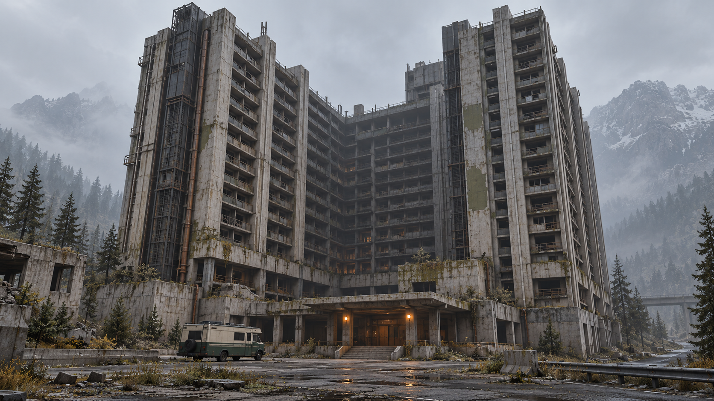
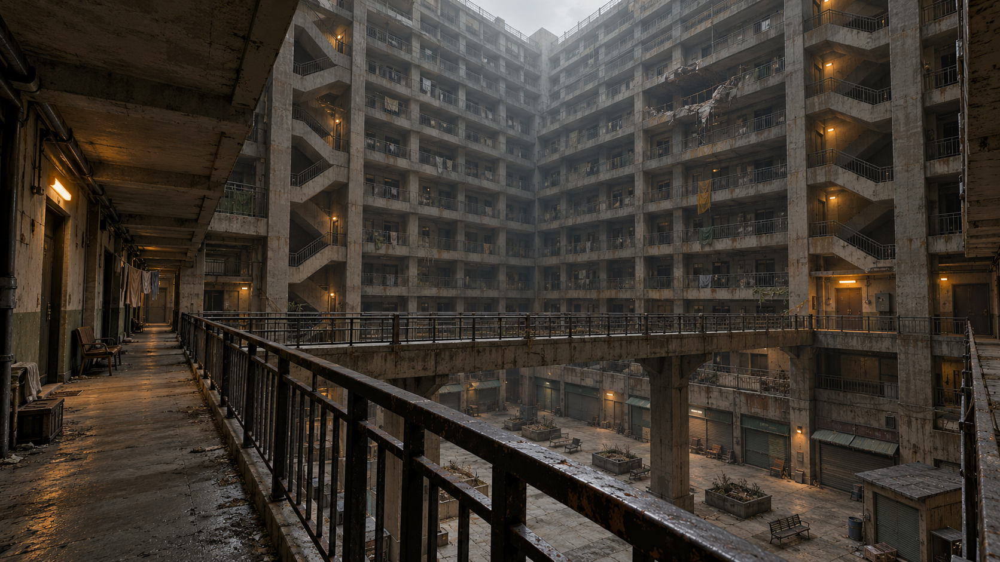

# 廢棄巨型住宅副本：灰井住宅城

日期：2026-10-22。狀態：設計提案與兩張概念圖完成；下列遊戲內容、尺寸、時間及數值均為製作目標，尚未實作或實機驗收。

[文件索引](../README.md) · [計畫總覽](README.md) · [概念圖、來源及完整提示詞](../art/graywell-megablock/README.md)

## 1. 設計核心

**一座曾容納整個生活圈、如今只剩回音的垂直住宅城。玩家停好 RV，進入底層市場，沿中庭逐層深入，找到可用設備，再打通搬運捷徑回車。**

暫名「灰井住宅城」，遊戲顯示名 `GRAYWELL BLOCK`，提議定義 ID `graywell_megablock`，室內 profile `megablock`。它原是工業聚落的集中住宅，周邊只留下低矮廢墟、舊服務道路與重新長回的森林，可放進目前公路世界。

住宅、雜貨市場、洗衣房、公共食堂、診療室與機電服務集中在同一量體。恐怖感來自大量住戶突然消失後的生活痕跡，以及隔著巨大中庭看得到卻暫時抵達不了的空間。主要辨識點是深中庭、重複住宅格、兩側核心筒與跨庭連橋。

建議首趟含支線的探索目標為 25–40 分鐘，熟悉後主路約 10–15 分鐘；需靠首版實際遊玩調整。

## 2. 建築外觀與尺度



| 項目 | 建議製作規格 |
|---|---|
| 主量體 | 約 96 × 72 m，U 形住宅翼圍繞深中庭；面向道路的一側由低層裙樓收口 |
| 高度 | 外觀約 24 層、層距 4.5 m，加屋頂機組約 116 m；灰盒時確認比例 |
| 中庭 | 約 32 × 24 m，從低層就能看到上方環廊與連橋 |
| 室外場址 | 先以約 144 × 144 m 預留建築、服務前庭、停車與接近動線；最終以真實占地及轉彎驗證定案 |
| 可玩首版 | B1、L1、L2、L3 四層，約 28–36 個模組；上方樓層作可見封閉量體 |
| 完整內容擴充 | 增加 L4、L5，形成六層可玩區；高層住宅與整棟屋頂另行排期 |
| RV 接近 | 前庭停靠區、旁側平坦搬運路；主入口台階之外設服務坡道 |

外觀使用粗混凝土肋柱、深凹住宅格、外露服務管與不對稱機電核心。街面入口用少量暖黃燈與厚雨棚形成視覺落點。上方以整段暗窗、斷電走道及封閉樓板表現未開放住宅；可玩區邊界須有實際碰撞與合理封口。

概念圖用來討論量體與氣氛，樓數、欄杆、樓梯、坡道和支撐均須依灰盒規格重作。圖中材質細節較正式低模版本豐富；實作沿用 D 風格的簡單幾何、粗材質與冷灰／土褐色，不照搬圖上的細碎污痕。

## 3. 樓層與一趟探索



| 樓層 | 主題與空間 | 玩法作用 |
|---|---|---|
| B1 | 裝卸區、水泵房、維修倉 | 選做支線，提供燃料與零件；較寬裝卸區可配置油桶人遭遇 |
| L1 | 出入口、管理室、封閉市場、中庭底部 | 建立方向感與回程記憶；主入口區保留退路，連接 RV |
| L2 | 小套房、洗衣房、公共食堂、東側環廊 | 第一次深入與房間搜刮；隔庭看見主目標所在翼樓 |
| L3 | 空中連橋、機電服務層、維修庫 | 橫跨中庭取得主目標，從內側開啟西側服務樓梯捷徑 |
| L4，後續 | 臨時避難住戶、封住的住宅走道 | 增加生活敘事與可選高風險物資路線 |
| L5，後續 | 社區診療室、上層公共平台 | 六層版本的深入目標；平台仍位於整棟大樓的低層 |

首版固定主路：

```text
RV → L1 市場／中庭 → 東側樓梯 → L2 住宅與食堂
                                   ↓ 上樓
RV ← L1 出口 ← 西側服務樓梯 ← L3 維修庫 ← L3 連橋
                   ↑              │
                   └── 從維修庫一側解開門栓

L1 管理室 ↔ B1 裝卸與水泵支線（可略過）
```

主目標先用既有標準引擎 Item，暫定 80% 耐久，作為有用的備用動力／回收設備；支線放大容量電池、引擎維修包與一般補給。獎勵數量、電池電量和收益在內容階段調整，不新增道具類別或製造配方。

大型引擎沿用雙手持物規則，不能同時拿手電筒。因此回程服務樓梯保留低亮度固定照明，路線夠寬、避免跳躍與梯子，讓搬運本身成立。捷徑是從內側解開門栓的實體門，開啟後可雙向通過；取得物資不封死玩家出口。

主路與雙核心筒位置固定，住宅支線的家具、可搜房間、封閉門及物資可以按 seed 變化。先手工驗證一條完整路線，再擴充隨機變體；必經節點不能依賴抽選剛好生成。主路初始尺寸：環廊淨寬約 2.8 m、連橋約 3 m，服務門洞先沿用 2.4 × 2.8 m，跨層距 4.5 m，最後以正式玩家、大型道具和 Raker 通行驗證。

## 4. 恐怖節奏與美術

1. **接近：** 公路轉角先露出低層立面，進入前庭抬頭才感受到整座住宅城。預設霧下仍須看清入口，不以修改全世界霧距來保證遠景。
2. **進場：** 市場鐵捲門、空食堂與管理處留下住戶生活痕跡；從中庭看見 L3 暖燈及連橋，預告目標。
3. **深入：** 住宅轉角縮短視線，再回到開放環廊放大尺度。遠側 Raker 的移動可被看見，追擊依正式 AI 的視線、距離與導航發生。
4. **取得：** 維修庫提供主物資及服務樓梯解鎖，讓玩家理解下一步是返程搬運。
5. **撤回：** 雙手搬運、樓梯轉角與既有敵人位置形成壓力；不因拾取目標憑空生成背後追兵。

首版固定配置 2 隻 Raker，分別檢查 L2 食堂側翼與 L3 維修區；入口附近不放必經伏擊。之後再試 2–4 隻的配置變化，避免跨層視線造成全樓同時追擊。油桶人只放在有空間退避的 B1 選做裝卸區，需先驗證爆風與返程，不直接放在狹窄住宅必經門口。Slender Speaker 不放進這次室內副本。

照明以中庭冷天光、房間暗部、樓梯及服務門的少量暖燈分層。固定應急燈屬室內照明，不連接 RV 電網。室內使用獨立 Environment，不繼承戶外濃霧；概念中的上方薄霧僅是美術目標。門牌及必要實體標誌使用英文，如 `EXIT`、`SERVICE`、`L2`；不把玩法提示烘進牆面貼圖。

優先模組：住宅立面格、實牆／門牆、環廊、轉角、連橋、樓梯平台、核心筒、裙樓店面、單人套房、食堂／洗衣房、維修庫及機電設備。混凝土、地板和通道用原生幾何精確組裝；複雜靜態家具可用 ComfyUI 分件產生並檢查。Visuals 與 Collision／互動／物資標記保持分離，同款重複件共享資產。

## 5. 分階段製作計畫

目前只交付本設計與概念圖。實作建議依下列階段交付可檢查成果，再依回饋調整下一階段；本表不代表已開始開發。

| 階段 | 交付物與工作 | 完成條件 |
|---|---|---|
| 1：量體與可走灰盒 | 獨立測試場：巨型外殼、前庭、B1–L3、雙樓梯、L3 連橋與捷徑；先固定布局 | 由駕駛視角辨識入口；正式玩家走完主路與支線，大型引擎可完整搬回 RV，無卡門或強制跳躍 |
| 2：住宅副本支援 | 新增 `megablock` profile／組裝分流、向上樓層與 B1 標示、固定主路 manifest、門狀態與內容快照；接入進出及地圖 | 進入／返回／取消正常；同局重返及室外檢查點讀取保留布局、捷徑、物資與敵人，不重抽或複製；原地堡不受影響 |
| 3：建築與室內美術 | 先完成一組立面格和一段含門／欄杆的環廊做實景風格樣板，再延伸整棟、家具、燈光與生活痕跡 | 外觀有清楚尺度、中庭有深度、暗部可判讀；外殼與室內視窗方向對應，替換外觀保留碰撞及通路 |
| 4：完整一趟內容 | 主物資、B1 支線、2 隻 Raker、搜刮點、音效及捷徑回程；主路固定，先做少量支線變體 | 一趟準備→探索→取得→搬運→回車可玩；量測實際耗時、手電電量與收益，回訪不補貨 |
| 5：正式世界接入 | 新 POI 定義、低頻大型場址排程、平地及道路／河川避讓、跨區塊保護、串流與效能調整 | 實際輪驅停靠、卸載／重返、讀檔及夜間可見性正常；量測接近、載入、中庭、追擊及返回成本後才納入正式生成 |
| 6：六層與重玩擴充 | 新增 L4／L5、診療室與避難層、支線組合、更多家具／照明變體及選做 B1 油桶人 | 各變體保證主路與返程可達，完整六層搬運、導航、保存與效能驗證；上方整棟探索另行設計 |

首版範圍包含四層探索與樓梯捷徑。可運作電梯、整棟逐層串流、整座建築破壞、新 Boss、任意外牆攀爬及室內磁碟存檔留作後續獨立需求。

## 6. 技術落地與已知限制

以下依 2026-10-22 工作樹的 [POI 共用規範](../guides/poi-authoring.md)、[地堡契約](../guides/bunker-interior.md) 與 [架構](../../architecture.md) 核對，非新功能驗收結果。

| 範圍 | 目前能力與計畫接點 |
|---|---|
| 外部資產 | 使用 `INSTANCE_ENTRANCE`；外觀 `.tscn`＋`world/poi_definitions/` 新定義，包含真實 building／site bounds、Entrance、ReturnPoint。登錄集中於 [poi_config.gd](../../world/poi_config.gd) |
| 室內類型 | 目前只接受 `bunker`。[poi_instance_manager.gd](../../world/instances/poi_instance_manager.gd) 目前統一建立 [PoiInterior](../../world/instances/poi_interior.gd)，後者綁定地堡目錄、內容及照明；住宅需要明確分流，不能只換 `.tres` |
| 布局與地圖 | [InteriorLayout](../../world/instances/interior_layout.gd) 現有最多 60 模組／3 層，朝 -Y 延伸，地圖採 B1–B3。新 profile 須定義真實高度、地上／地下層標籤、固定主路及驗證；不可直接提高共用上限就當成完成 |
| 保存 | [CheckpointSchema](../../core/checkpoint_schema.gd) 現在按地堡驗證布局與內容，需要與 profile 同步分流，新增門狀態與住宅內容驗證；保存實際結果，不依 seed 重建 |
| 世界與版本 | 登錄不等於加入生成。新排程使用獨立 RNG，先做合法大場址與道路接近；不改既有四入口抽樣順序來偷接新棟。內容及格式若不相容，明確驗證版本或要求新局，不承諾舊檔遷移 |
| RV 與返回 | RV 留在持續運行的室外世界；無自動凍結或保護。入口停靠與返回點須驗證淨空，帶入設備不會自動連上 RV 服務。獨立 World3D 中庭窗外使用對應方向的簡化景觀，近處不露出理應可見的 RV 位置，避免誤導為跨世界即時視窗 |
| 載入成本 | 現有室內一次組裝並烘焙導航，沒有任意逐層串流。四層先以共用模組、封閉上層及可見性分區控制成本；上方量體不建立完整可走房間或動態物件 |

新增組裝器先保留地堡既有行為，抽出兩者確實共用的最小接口即可。主結構、內容與燈光使用各自 RNG，物資只由管理者首訪生成。模組驗證包含上下樓梯連通、所有必經點可達、門開啟後的搬運淨空，以及未開放樓層封口。

## 7. 驗收方式與本次交付

本次只做設計與概念圖：已人工檢查兩張圖的建築、入口、量體、中庭、連橋與美術方向，核對規格與程式限制，並檢查新增文件的相對連結及差異；未啟動 Godot、未跑遊戲測試、未證實任何規劃中的通行或效能。

後續改到轉場／保存時，執行 `scripts/test.ps1 -TestFilter test_poi_transition_persistence.gd` 並按新增風險擴充既有測試。新 profile／定義須做 `validate()`／`validate_scene()`、實際導航及搬運走查，核心轉場測試不能代替。人工驗收包含白天／夜間接近、L1→L3 完整路線、B1 支線、雙手搬運、捷徑重返與回到 RV。效能採相同機器／設定與既有地堡對照，記錄載入時間、幀時間及動態物件成本後訂預算，不預先宣稱整棟效能達標。

下一個適合開始的交付是階段 1：**能實際停車、進門、登上連橋，再把一具大型引擎搬回 RV 的四層灰盒。**
